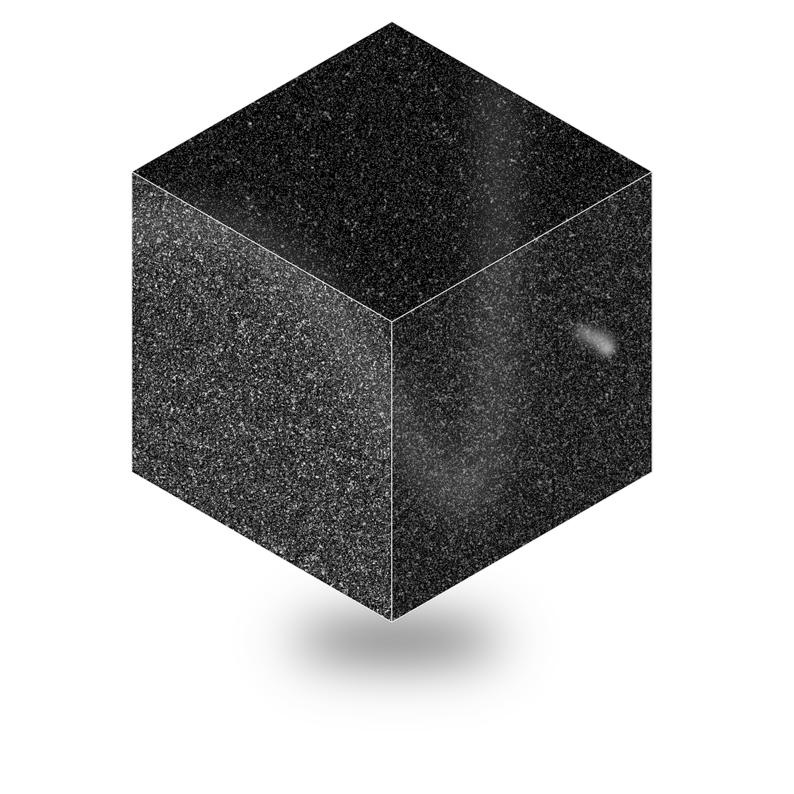

# Welcome to Void.

	

Void is the open-source Cursor alternative.

Use AI agents on your codebase, checkpoint and visualize changes, and bring any model or host locally. Void sends messages directly to providers without retaining your data.

This repo contains the full sourcecode for Void. If you're new, welcome!

## Note

The original Void project is archived: its development has stopped, and patches are not accepted upstream. This is a fork maintained independently.

## Reference

For a guide to the codebase, see [VOID_CODEBASE_GUIDE](./VOID_CODEBASE_GUIDE.md).

For a guide on how to work on your own version of Void, see [HOW_TO_CONTRIBUTE](./HOW_TO_CONTRIBUTE.md). For build instructions, see [BUILD](./BUILD.md).
